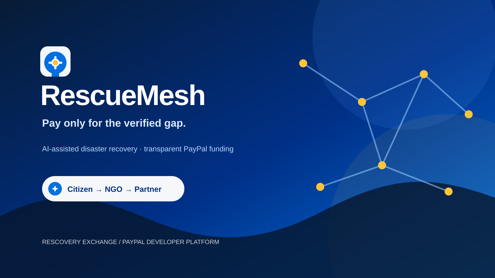

# RescueMesh

### Pay only for the verified gap.



<p align="center"></p>

RescueMesh is a rights-first disaster recovery exchange. A household requests help, an NGO checks consent and nearby entitlement capacity, local partners publish what they can fulfil, and PayPal funds only the remaining verified gap.

This is more than a payment checkout: it is a transparent chain from incident → entitlement → allocation → authorization → fulfilment → capture → donor notification.

## What is novel

- **Entitlement-aware funding:** use public/FPS capacity before asking donors to pay.
- **Gap-only payments:** PayPal funds only medicine, delivery, or other unmet needs.
- **Proof-gated capture:** funds are authorized first and captured only after NGO verification.
- **Traceable money flow:** missions, allocations, PayPal orders, captures, destinations, and notifications are recorded in SQLite.
- **Privacy by design:** no Aadhaar numbers, ration-card numbers, OTPs, biometrics, or government credentials are collected.
- **Multi-sided experience:** citizen, NGO, merchant/FPS, and donor dashboards.

## Product flow

```text
Citizen request → NGO consent and entitlement check → FPS / merchant allocation
→ PayPal authorization → fulfilment verification → PayPal capture
→ SQLite ledger → donor notification and audit trail
```

## Architecture

```text
React + Vite (citizen, NGO, merchant, donor dashboards)
          │ REST + WebSocket events
FastAPI + SQLite (missions, allocation, ledger, notifications)
          │ OAuth + Orders v2 AUTHORIZE/CAPTURE
PayPal Sandbox (Personal buyer → Business seller)
```

## Run locally

### API

```powershell
cd apps/api
python -m venv .venv
.\.venv\Scripts\Activate.ps1
pip install -r requirements.txt
Copy-Item .env.example .env
python -m uvicorn app.main:app --reload --host 127.0.0.1 --port 8001
```

### Web

```powershell
cd apps/web
npm install
Copy-Item .env.example .env
npm run dev -- --host 127.0.0.1 --port 5189
```

Open `http://127.0.0.1:5189`.

## Deploy to Render

The repository includes `render.yaml`, a Render Blueprint with two services:

- `rescuemesh-api` — FastAPI backend on Render Web Service
- `rescuemesh-web` — React/Vite static frontend

The API includes `apps/api/Dockerfile`, based on Python 3.12, so Render does not select Python 3.14 and attempt a Rust source build of `pydantic-core`.

For a manual Render API service, choose **Docker**, set Root Directory to `apps/api`, and set Dockerfile Path to `Dockerfile`. Do not use Python build/start commands for the Docker service.

### Blueprint setup

1. Push this repository to GitHub.
2. In Render, choose **New → Blueprint**.
3. Select the `RescueMesh-paypal` repository and the `main` branch.
4. Render detects `render.yaml` and creates both services.
5. Open the `rescuemesh-api` service environment settings and add `PAYPAL_CLIENT_ID`, `PAYPAL_CLIENT_SECRET`, and optionally `PAYPAL_MCP_ACCESS_TOKEN` as secret values.
6. Open the `rescuemesh-web` service environment settings and add `VITE_PAYPAL_CLIENT_ID` using the same Sandbox REST app Client ID.
7. Deploy both services. The frontend uses `https://rescuemesh-api.onrender.com` and the API allows Render origins through CORS.
8. Test `https://rescuemesh-api.onrender.com/api/health` before opening the frontend URL.

For production, replace Sandbox credentials and endpoints only after completing PayPal’s production onboarding and webhook/reconciliation checks.

## Environment

Backend `apps/api/.env`:

```env
PAYPAL_CLIENT_ID=your_sandbox_rest_client_id
PAYPAL_CLIENT_SECRET=your_sandbox_rest_secret
PAYPAL_ENVIRONMENT=sandbox
PAYPAL_CURRENCY=USD
FRONTEND_ORIGIN=http://127.0.0.1:5189
PAYPAL_MCP_URL=https://mcp.sandbox.paypal.com/http
PAYPAL_MCP_ACCESS_TOKEN=
```

Frontend `apps/web/.env`:

```env
VITE_API_URL=http://127.0.0.1:8001
VITE_PAYPAL_CLIENT_ID=your_sandbox_rest_client_id
VITE_PAYPAL_CURRENCY=USD
```

Never commit `.env`, secrets, OAuth tokens, or MCP tokens. Use Sandbox Personal accounts as buyers and Business accounts as sellers. For a first-party integration, use a standard REST app under the Business account.

## Demo walkthrough

1. Register an FPS or merchant with inventory such as `rice:20, medicine:5`.
2. Create a citizen mission such as `rice:5, medicine:1`.
3. In the NGO command center, run consent and allocation.
4. Authorize the PayPal gap with a Sandbox Personal buyer.
5. Verify fulfilment and capture the authorized payment.
6. Open **My giving** to see the completed transfer, destination, ledger entry, and notification.
7. Use **Settings → Data management** to delete records or clear the local SQLite workspace.

## Safety and scope

Government entitlement and FPS checks are represented by a consent-based adapter and fictional records. Production would require formal government/partner agreements, PayPal webhooks, reconciliation, role-based access, retention policies, and audit-grade monitoring.

## AG Grid sponsor integration

RescueMesh uses AG Grid Community for the interactive donor transaction ledger. The frontend installs `ag-grid-react` and `ag-grid-community`, then provides all Community features through `AllCommunityModule` and `AgGridProvider` in `apps/web/src/main.jsx`:

```jsx
import { AllCommunityModule } from 'ag-grid-community'
import { AgGridProvider } from 'ag-grid-react'

const agGridModules = [AllCommunityModule]

<AgGridProvider modules={agGridModules}>
  <App />
</AgGridProvider>
```

The **Transaction ledger · AG Grid** uses `AgGridReact` with dynamic SQLite-backed rows, sorting, filtering, pagination, animated rows, PayPal capture IDs, destination providers, mission IDs, statuses, currencies, and timestamps. See the [AG Grid React getting started guide](https://www.ag-grid.com/react-data-grid/getting-started/).

## Sponsor technologies

- **Postman** — an importable collection in `postman/RescueMesh.postman_collection.json` demonstrates the live API lifecycle from health check and mission creation through allocation, PayPal order creation, and capture.
- **AG Grid** — the donor dashboard contains the dynamic transaction ledger with filtering, sorting, pagination, and PayPal capture metadata.
- **Render** — deployment-ready architecture is documented, but no Render-hosted production URL is claimed in this repository.

The repository intentionally describes only integrations that are present in code. Add a Postman workspace screenshot under `docs/` if you want it displayed here; no screenshot was found in the current `apps/api/models` directory.

## License

Add the license required by your hackathon or organization before publishing.
